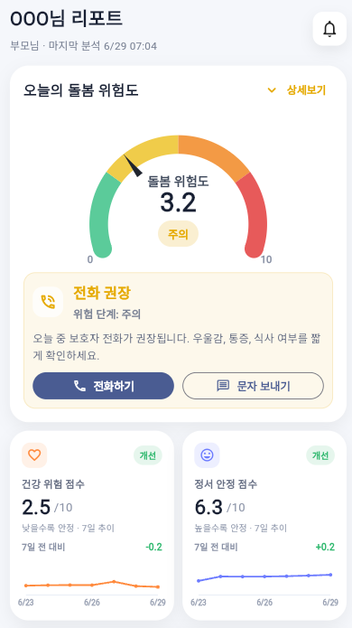
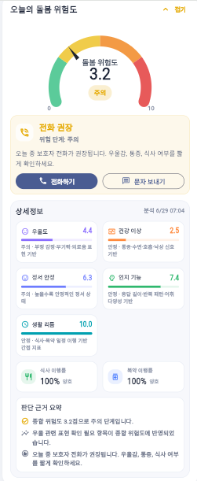
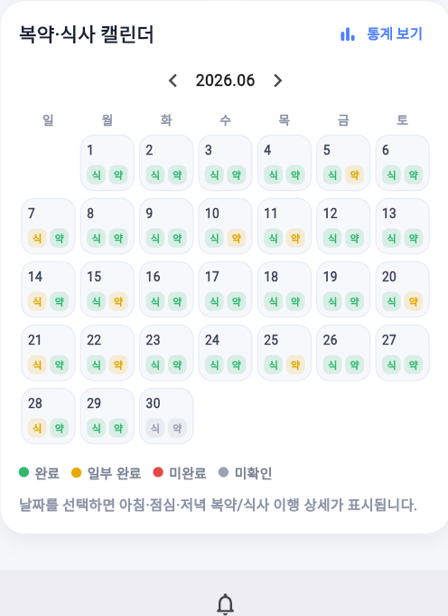
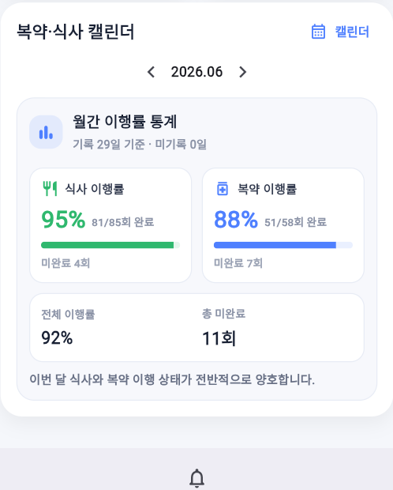

# hyope_frontend

Hyope 서비스의 보호자/관리자용 Flutter 프론트엔드입니다.

## 주요 화면

* 대시보드
* 복약/식사 캘린더
* 이행률 통계 보기
* 알림 설정
* 사용자 설정

## 주요 기능

* 종합 위험도 게이지 표시
* 건강 지표 카드 표시
* 복약/식사 기록 캘린더 표시
* 월간 이행률 통계 표시
* 하단 탭을 이용한 화면 전환


## 프로젝트 구조

```text
lib/
├─ main.dart
├─ app.dart
├─ screens/
├─ widgets/
├─ models/
├─ data/
├─ utils/
└─ painters/
```

## 실행 방법

```bash
flutter pub get
flutter run
```

Chrome에서 실행하려면 다음 명령어를 사용합니다.

```bash
flutter run -d chrome
```

## Screenshots

### Dashboard



